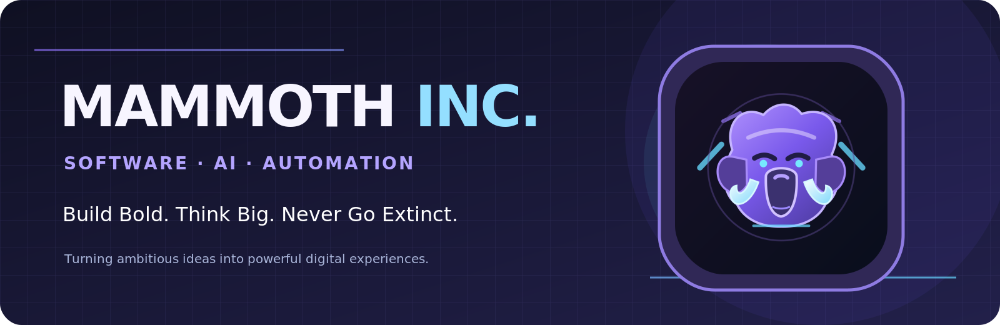

<div align="center">



<br/>

[](#what-we-build)
[](#what-we-build)
[](#our-philosophy)

### 🦣 Big ideas deserve powerful software.

**We design, build, and experiment with software that makes life smarter, work easier, and ideas real.**

[Explore our founder](https://github.com/mammoth-code) · [View our work](https://github.com/mammoth-code?tab=repositories)

</div>

---

## 🚀 Who we are

**Mammoth Inc.** is an independent software-building identity driven by curiosity, creativity, and a love for engineering. We're interested in the space where **full-stack development, AI, smart automation, and thoughtful design** come together.

Founded on one simple principle: **don't just write code — build something worth using.**

We like clean architecture, delightful interfaces, meaningful automation, and experiments bold enough to teach us something new.

## ⚡ What we build

| Focus | What it means to us |
|:--|:--|
| 🌐 **Full-stack products** | Modern web platforms, apps, dashboards, and APIs. |
| 🤖 **AI-powered tools** | Practical AI integrations, agent workflows, and intelligent features. |
| ⚙️ **Automation** | Systems that reduce busywork and eliminate repetitive tasks. |
| 🎨 **UI / UX design** | Polished, accessible interfaces that feel as good as they work. |
| 🧪 **Developer tooling** | Creative engineering experiments and productivity tools. |

## 🧬 Our DNA

```ts
const mammothInc = {
  mindset: 'Think big. Ship thoughtfully.',
  specialties: ['Full-stack', 'AI', 'Automation', 'Design'],
  values: ['Curiosity', 'Craftsmanship', 'Reliability', 'Creativity'],
  mission: 'Make boring tasks extinct 🦣',
};

while (ideas.length > 0) {
  const idea = ideas.shift();
  design(idea);
  build(idea);
  test(idea);
  improve(idea);
}
```

## 🛠️ Technologies we enjoy

<div align="center">


</div>

## 💡 Our philosophy

> **Code like a Mammoth. Build things that won't go extinct.**

Great software should be **useful, maintainable, performant, and enjoyable**. We believe in exploring new possibilities without forgetting the fundamentals.

- 🧠 **Stay curious** — there is always a better question to ask.
- 🏗️ **Build with purpose** — thoughtful products beat feature overload.
- 🚀 **Keep improving** — iteration is part of the craft.
- 🦣 **Leave a footprint** — make something that matters.

## 🤝 Connect

Mammoth Inc. is shaped by the developer behind [**@mammoth-code**](https://github.com/mammoth-code). Follow along for experiments, tools, and future public releases.

<div align="center">

---

### ❄️ Built different. Built to last.

**Mammoth Inc.** · *Never go extinct.* 🦣

</div>
